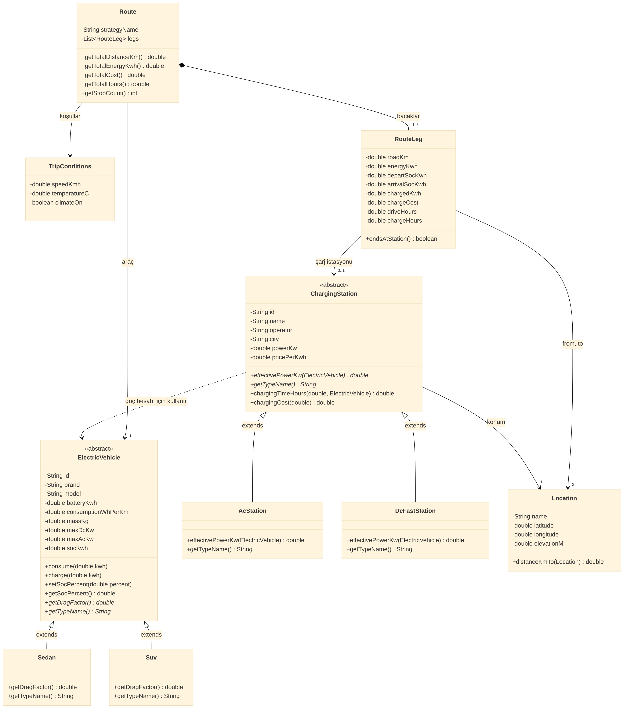
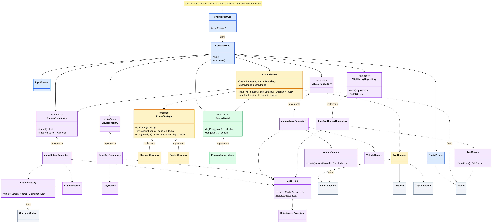

# ChargePath ⚡ Elektrikli Araç Şarj ve Rota Planlama

Kırklareli Üniversitesi, Yazılım Mühendisliği, **Nesneye Yönelik Programlama** dönem projesi.

ChargePath, bir elektrikli aracın **kalan bataryasıyla** belirli yol koşullarında ne kadar gidebileceğini hesaplayan ve Trakya bölgesindeki şarj istasyonlarını kullanarak **en ucuz** ya da **en hızlı** rotayı bulan bir **Java konsol uygulamasıdır**.

```
 DEMO: Togg T10X Long Range RWD, %40 batarya, kış (2 °C), klima açık, 110 km/s

                           En ucuz       En hızlı
 Şarj ücreti             581,02 TL      840,99 TL
 Toplam süre            7 sa 53 dk     2 sa 56 dk
 Durak sayısı                    2              2
```

## İçindekiler

1. [Özellikler](#özellikler)
2. [Kurulum ve çalıştırma](#kurulum-ve-çalıştırma)
3. [Proje yapısı](#proje-yapısı)
4. [UML sınıf diyagramı](#uml-sınıf-diyagramı)
5. [Nesneye yönelik programlama ilkeleri](#nesneye-yönelik-programlama-ilkeleri)
6. [SOLID ilkeleri](#solid-ilkeleri)
7. [Tasarım kalıpları](#tasarım-kalıpları)
8. [Algoritma: batarya kısıtlı Dijkstra](#algoritma-batarya-kısıtlı-dijkstra)
9. [Enerji modeli](#enerji-modeli)
10. [Veri ve kalıcılık](#veri-ve-kalıcılık)
11. [Birim testleri](#birim-testleri)
12. [Varsayımlar ve sınırlamalar](#varsayımlar-ve-sınırlamalar)

## Özellikler

| Menü | Ne yapar? |
|---|---|
| 1. Araçları listele | 4 gerçek araç (Togg T10X, Togg T10F, Tesla Model Y, Tesla Model 3) ve teknik değerleri |
| 2. İstasyonları listele | Trakya'da 28 şarj istasyonu (17 DC, 11 AC), güç ve kWh fiyatı |
| 3. Menzil hesapla | Batarya yüzdesi, hız, sıcaklık ve klimaya göre tahmini menzil |
| 4. Rota planla | Seçilen stratejiyle (en ucuz / en hızlı) şarj duraklı rota, bacak bacak batarya çubuğu |
| 5. Karşılaştır | Aynı yolculuk için iki stratejinin ücret, süre ve durak karşılaştırması |
| 6. Yolculuk geçmişi | Planlanan rotalar `data/trip_history.json` dosyasına kaydedilir, program kapansa da kaybolmaz |
| 7. Demo senaryosu | Edirne'den İstanbul'a, kışın, %40 bataryayla hazır senaryo |

## Kurulum ve çalıştırma

Gereksinimler: **JDK 21 veya üstü**, Maven (IntelliJ IDEA içinde hazır gelir). İnternet bağlantısı gerekmez, tüm veri `data/` klasöründedir.

**IntelliJ IDEA ile**

1. Projeyi açın, sağdaki Maven panelinden **Reload** yapın.
2. `src/main/java/com/chargepath/app/ChargePathApp.java` dosyasını açıp ▶ ile çalıştırın.
3. Testler için `src/test/java` klasörüne sağ tıklayıp **Run 'All Tests'** seçin.

> Çalışma dizini (working directory) proje kök klasörü olmalıdır, çünkü veriler `data/` klasöründen okunur. IntelliJ bunu varsayılan olarak böyle ayarlar.

**Komut satırı ile**

```bash
mvn test                                   # 30 birim testini çalıştırır
mvn compile exec:java                      # menülü uygulama
mvn compile exec:java -Dexec.args="--demo" # sadece demo senaryosu
```

## Proje yapısı

```
charge-path/
├── data/
│   ├── vehicles_fallback.json   araç teknik verileri (çevrimdışı)
│   ├── stations_fallback.json   şarj istasyonları (çevrimdışı)
│   ├── cities.json              başlangıç/varış şehirleri
│   └── trip_history.json        program çalışınca oluşur (yolculuk geçmişi)
├── docs/
│   ├── uml-model.(mmd|png|pdf|svg)    alan modeli UML diyagramı
│   └── uml-mimari.(mmd|png|pdf|svg)   mimari UML diyagramı
├── src/main/java/com/chargepath/
│   ├── model/     Location, TripConditions, ElectricVehicle, Sedan, Suv,
│   │              ChargingStation, AcStation, DcFastStation, RouteLeg, Route
│   ├── energy/    EnergyModel, PhysicsEnergyModel
│   ├── routing/   RouteStrategy, CheapestStrategy, FastestStrategy, TripRequest, RoutePlanner
│   ├── data/      *Repository arayüzleri, Json*Repository, VehicleFactory, StationFactory,
│   │              TripRecord, JsonFiles, DataAccessException, *Record (DTO)
│   └── app/       ChargePathApp, ConsoleMenu, InputReader, RoutePrinter
└── src/test/java/com/chargepath/   30 JUnit 5 testi
```

Toplam **37 sınıf ve arayüz**. Paketler katman katman ayrılmıştır: `app` kullanıcıyla konuşur, `routing` karar verir, `energy` hesaplar, `data` okur/yazar, `model` alanı temsil eder.

## UML sınıf diyagramları

Diyagram okunabilir olsun diye ikiye bölündü. Resimler GitHub'da küçük görünür; **yakınlaştırmak için PDF (vektör, kayıpsız büyür) ya da SVG sürümünü açın.**

### 1. Alan modeli (`model` paketi): araç, istasyon, rota

[PDF olarak aç (yakınlaştırılabilir)](docs/uml-model.pdf) · [SVG](docs/uml-model.svg)



### 2. Mimari: katmanlar, arayüzler, kalıplar

Renkler: mavi `app`, sarı `routing`, yeşil `energy`, mor `data`, gri `model`. Kesik çizgi bağımlılık, içi boş üçgen kalıtım ya da arayüz uygulama, düz ok ilişkidir.

[PDF olarak aç (yakınlaştırılabilir)](docs/uml-mimari.pdf) · [SVG](docs/uml-mimari.svg)



Kaynak dosyalar: `docs/uml-model.mmd` ve `docs/uml-mimari.mmd` (Mermaid).

## Nesneye yönelik programlama ilkeleri

| İlke | Projede nerede? |
|---|---|
| **Sınıf ve nesne** | Her araç, istasyon ve şehir JSON'dan okunup bir nesneye dönüşür. |
| **Kapsülleme** | Tüm alanlar `private`. Batarya seviyesi (`socKwh`) sadece `consume()` ve `charge()` ile değişir; bu metotlar seviyenin 0'ın altına ya da kapasitenin üstüne çıkmasını engeller. `Route.getLegs()` salt okunur liste döner. |
| **Kalıtım** | `Sedan` ve `Suv`, `ElectricVehicle`'dan; `AcStation` ve `DcFastStation`, `ChargingStation`'dan türer. |
| **Soyutlama** | `ElectricVehicle` ve `ChargingStation` soyut (`abstract`) sınıflardır; `EnergyModel`, `RouteStrategy` ve depolar arayüzdür. |
| **Çok biçimlilik** | `station.effectivePowerKw(vehicle)` çağrısı AC istasyonda aracın AC sınırını, DC istasyonda DC sınırını ve şarj eğrisini kullanır. `vehicle.getDragFactor()` sedan ve SUV için farklı sonuç verir. Çağıran kod hangi alt sınıf olduğunu bilmez. |

## SOLID ilkeleri

| İlke | Uygulama |
|---|---|
| **S** Tek sorumluluk | `RoutePlanner` sadece rota planlar; ekrana yazmak `RoutePrinter`'ın, girişi okumak `InputReader`'ın, dosya okumak depoların işidir. |
| **O** Açık/kapalı | Yeni bir strateji (örneğin "en az durak") için `RouteStrategy`'yi uygulayan yeni bir sınıf yazmak yeterlidir, `RoutePlanner` değişmez. Yeni istasyon tipi için sadece `StationFactory`'ye bir satır eklenir. |
| **L** Liskov yerine geçme | Planlayıcı `ChargingStation` ile çalışır; `AcStation` ya da `DcFastStation` verilmesi sonucu bozmaz. Kodda `instanceof` ile tip kontrolü yoktur. |
| **I** Arayüz ayrımı | Arayüzler küçüktür: `EnergyModel` (2 metot), `RouteStrategy` (3 metot), `StationRepository` (2 metot). Kimse kullanmadığı metodu uygulamak zorunda kalmaz. |
| **D** Bağımlılığın tersine çevrilmesi | `RoutePlanner` somut sınıflara değil, `StationRepository` ve `EnergyModel` arayüzlerine bağlıdır ve bunları kurucudan alır. Tüm nesneler sadece `ChargePathApp.main` içinde üretilir. Bu sayede testlerde JSON dosyası yerine bellekte çalışan sahte bir depo verilebilir. |

## Tasarım kalıpları

| Kalıp | Sınıflar | Neden? |
|---|---|---|
| **Strategy** | `RouteStrategy`, `CheapestStrategy`, `FastestStrategy` | Aynı Dijkstra algoritması, farklı "maliyet" tanımlarıyla çalışır. |
| **Factory** | `VehicleFactory`, `StationFactory` | JSON'daki `type` alanına bakıp doğru alt sınıfı (`Sedan`/`Suv`, `AcStation`/`DcFastStation`) üretme kararı tek yerde verilir. |
| **Repository** | `StationRepository`, `VehicleRepository`, `CityRepository`, `TripHistoryRepository` | Verinin nereden geldiği (JSON, ileride veritabanı) programın geri kalanından gizlenir. |
| **Static factory method** | `TripRecord.from(route)` | Bir rotadan geçmiş kaydı üretmenin okunaklı yolu. |

## Algoritma: batarya kısıtlı Dijkstra

Klasik Dijkstra en kısa yolu bulur. Elektrikli araçta "en kısa" yetmez: **batarya bitmemeli**. Bu yüzden algoritma her yeri **batarya seviyesiyle birlikte** düşünür.

```
 Durum = (yer, batarya %)

  %80   . . . [Lüleburgaz DC] ──── sür ────► [İstanbul]  (varışta ≥ %10 kalmalı)
              ▲ şarj (ücret / süre ekler)
  %22   . . . [Lüleburgaz DC]
              ▲ sür (yol enerji yer, batarya düşer)
  %40   [Edirne]
```

1. **Düğümler:** başlangıç, varış ve 28 istasyon. Her biri %0 ile %100 arasında 101 batarya katına sahiptir.
2. **Sür kenarı:** bir yerden diğerine. Varışta bataryada **%10 yedek** kalmıyorsa bu kenar yoktur. Kısıt budur.
3. **Şarj kenarı:** bir istasyonda daha yüksek bir yüzdeye çıkmak (en fazla %80; DC şarj bundan sonra belirgin yavaşlar).
4. **Ağırlık:** stratejiden gelir. En ucuzda ödenen TL, en hızlıda sürüş + şarj süresi + her durak için 5 dakika.
5. `PriorityQueue` en düşük ağırlıklı durumu önce çıkarır; varış ilk kez çıktığında en iyi rota bulunmuş olur.

Karmaşıklık: yaklaşık 30 yer × 101 seviye × 2 aşama ≈ 6 000 durum; bir rota bir saniyenin çok altında hesaplanır.

Mesafe: iki nokta arasındaki kuş uçuşu mesafe **Haversine** formülüyle hesaplanır ve karayolu tahmini için **1,3** katsayısıyla çarpılır.

## Enerji modeli

```
 Toplam (kWh) = Sürüş + Klima + Yokuş − Rejeneratif kazanç

 Sürüş = km × tüketim × hızÇarpanı × sıcaklıkÇarpanı
         hızÇarpanı = 0,6 + 0,4 × hava direnci × (hız / 90)²
 Klima = klima gücü (kW) × süre (saat)
 Yokuş = (araç + 150 kg) × 9,81 × Δh / 3 600 000 / 0,90
 Rejen = (araç + 150 kg) × 9,81 × |Δh| / 3 600 000 × 0,60
```

| Değişken | Etki |
|---|---|
| Hız | Hava direnci hızın karesiyle artar. 90 km/s katalog tüketimidir. |
| Gövde | SUV'un hava direnci sedana göre %15 fazla kabul edilir. |
| Sıcaklık | 20 °C altında her derece %0,5 ek tüketim (en fazla %25). |
| Klima | Isıtma 18 °C altında 1 kW + derece başına 0,1 kW; soğutma 24 °C üstünde 0,5 kW + derece başına 0,1 kW. |
| Eğim | Yükseklik verileri SRTM'den alınmıştır. Tırmanışta enerji harcanır, inişte %60'ı geri kazanılır. |

## Veri ve kalıcılık

| Dosya | İçerik | Kaynak |
|---|---|---|
| `vehicles_fallback.json` | Batarya, tüketim, ağırlık, DC/AC şarj gücü | ev-database.org, evkx.net |
| `stations_fallback.json` | 28 istasyon: konum, tip, güç, kWh fiyatı, rakım | Konumların bir kısmı © OpenStreetMap katkıda bulunanları; fiyatlar chargemate.io ve piyasa ortalaması; rakım SRTM 90 m |
| `cities.json` | 12 şehir merkezi | Yaklaşık koordinat, rakım SRTM 90 m (OpenTopoData) |
| `trip_history.json` | Planlanan yolculuklar | Program tarafından yazılır |

Uygulama tamamen **çevrimdışı** çalışır. JSON okuma/yazma için Gson kütüphanesi kullanılır.

> **Uyarı:** İstasyon konumları simülasyon amaçlı işaretlenmiştir, gerçek istasyonların varlığı ve güncelliği garanti edilmez. Güç ve fiyat değerlerinin bir kısmı varsayımdır; her kaydın `notes` alanında belirtilmiştir.

## Birim testleri

`mvn test` ile **30 test** çalışır (JUnit 5).

| Test sınıfı | Ne doğrulanıyor? |
|---|---|
| `LocationTest` (4) | Haversine mesafesi, simetri, geçersiz enlem reddi |
| `ElectricVehicleTest` (6) | Kapsülleme kuralları: tüketim, kapasite sınırı, geçersiz değer, çok biçimlilik |
| `ChargingStationTest` (3) | AC gücünü aracın sınırlaması, DC'nin hızı, ücret hesabı |
| `PhysicsEnergyModelTest` (5) | Katalog tüketimi, hızın etkisi, eğim ve rejeneratif fren, kış menzili, klima |
| `VehicleFactoryTest` (3) | Doğru alt sınıf üretimi, büyük/küçük harf, bilinmeyen tip |
| `JsonRepositoryTest` (4) | Gerçek veri dosyalarının okunması, eksik dosya hatası, geçmişin kalıcılığı |
| `RoutePlannerTest` (5) | Doğrudan yolculuk, zorunlu şarj durağı, rota yoksa boş sonuç, yedek payın korunması, stratejilerin doğru karar vermesi |

## Varsayımlar ve sınırlamalar

- Karayolu mesafesi gerçek yol ağı yerine kuş uçuşu × 1,3 ile tahmin edilir.
- Şarj gücü sabit kabul edilir (DC için tepe gücün %85'i). Gerçekte şarj eğrisi bataryanın doluluğuna göre değişir.
- Trafik, rüzgâr ve istasyonda bekleme kuyruğu hesaba katılmaz.
- Başlangıçtaki bataryanın ücreti hesaba katılmaz, sadece yolda ödenen şarj ücreti gösterilir.

## Geliştirici

Samet Muhammed Ali Şafak ([github.com/wreazy-cs](https://github.com/wreazy-cs))
